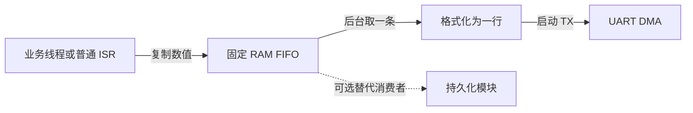

# 异步日志怎么工作

## 先记录问题，再输出

业务代码碰到错误时，通常已经知道错误类型和几个有用的数值。例如，某个寄存器读取失败时，可以记录寄存器地址和返回值。现场不必立即拼出一句话，更不必等 UART 把这句话发完。

这个思路来自原工程的 Diagnostic。原工程把数值事件交给独立线程写 Flash，下一次上电再用 UART 回放，此外还有专门的 DMA 调试打印。仓库保留数值事件队列，提供运行时 UART 消费者，以及可选的 Flash 保存与上电回放。

从旧工程迁移时，可沿用 `LOG_SAVE_ERR2()`、项目自己的文件与错误编号，以及 `error_log_save2()`、`error_log_try_pop()` 和 `error_log_get_stats()` 的用法。已使用原版 Diagnostic 的工程只保留一份同名队列实现。原来的 Flash 与上电回放继续由该工程的 Service、Storage 和板级驱动管理。

| 阶段 | 成功的含义 |
| --- | --- |
| `LOG_SAVE_ERR2` 返回 `ERROR_LOG_OK` | 记录已复制进 RAM。业务立即继续。 |
| `error_log_try_pop` 成功 | 槽位已释放，记录归唯一的消费者。 |
| DMA 传输完成 | DMA 已写完外设发送寄存器。UART 移位寄存器可能还在发送。 |
| UART `TC` / 适配器报告 `TX_COMPLETE` | 最后一个停止位已离开发送端，消费者可以复用行缓冲。 |
| 自定义持久化写入成功 | 需由 Storage 的读回或完整性规则确认，和 RAM 入队、出队分别计数。 |

## 如何控制日志开销

- 一条记录是七个 `uint32_t`。分别记录本次启动的顺序号、Tick、文件编号、行号、错误编号、两个参数。宏从调用点取得行号，文件编号由项目登记。保留固件版本对应的编号表和源码，才能解释旧版本的行号。
- FIFO 只用静态数组和读写下标。提交和出队都在短临界区里复制固定字节数。记录满时丢新保旧，业务无需等待，满队列次数可通过 `error_log_get_stats()` 观察。
- 格式化放在消费者中，使用单个固定行缓冲。发送暂时忙时保留此行。启动后直到驱动报告完成或已停止的错误，缓冲都保持不动。已出队的格式化/传输错误进入 `dropped_count`。
- DMA 能减少 CPU 搬字节的工作，串口速率仍然限制吞吐。115200 baud、8N1 每字节占 10 bit，理论吞吐约 11,520 B/s，100 字节耗时约 8.7 ms，实际还要加后台轮询和帧间空闲。扩大 FIFO 能吸收短时突发。持续产生得更快时，应减少重复日志或降低记录频率。

同步只覆盖 FIFO。UART 对象由一个后台调用者持有，同一个 UART TX 也应由一个驱动管理。其他诊断代码要共用 UART 时，通过同一个发送入口安排顺序，避免轮询 `printf` 和 DMA 交错写 TX。

## 如何扩展到重启后回放

将 UART 消费者换成一个保存线程，由它调用 `error_log_try_pop()` 并编码。想同时显示实时日志和持久化日志时，让同一个消费者处理两种输出，有明确的队列或缓冲所有权。两个独立线程各自对同一个 FIFO 出队，会各拿到一部分记录。

原工程的可复用设计如下。

1. 为日志划定独立 Flash 区。核对新的芯片页大小、最小编程单位、擦除粒度、应用链接范围和升级擦除策略。
2. 显式编码版本号、记录长度、固件版本、记录字段、完整性校验和提交标记。安排最后一个独立编程单位写入提交标记。上电只接受格式正确、已提交且校验通过的记录。
3. 预留独立统计给写满、写失败和损坏槽位。跳过半写槽，回放无需修改 Flash。写满后的保留和回收策略根据产品需求决定。
4. 真实硬件上测掉电、擦写期间的任务与中断响应，以及升级对日志区的影响。

当前 Flash 选项默认关闭。启用后可选已有 STM32F411 或 GD32F303CGT6 适配，也可按目标芯片补充驱动。接入步骤、存储格式和启动输出示例见 [Flash 保存与上电回放](flash.md)。
